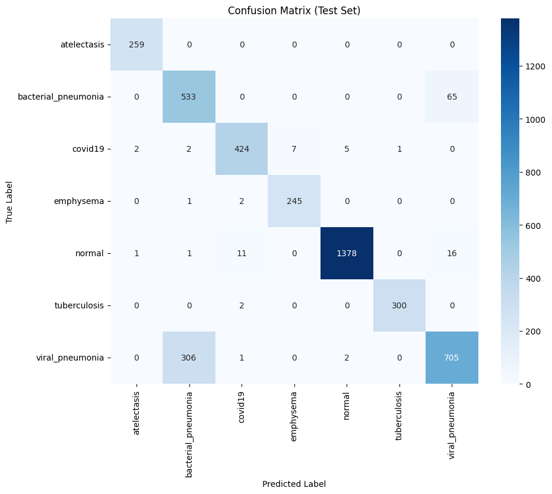
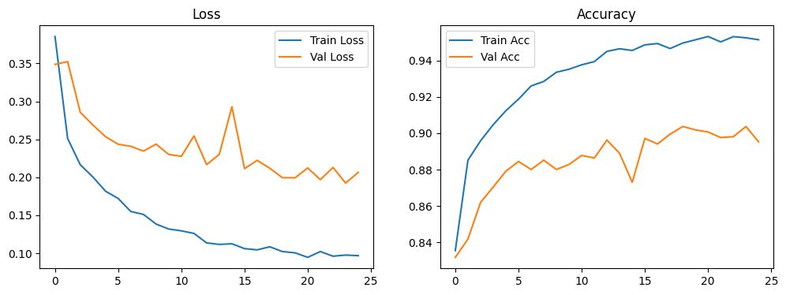
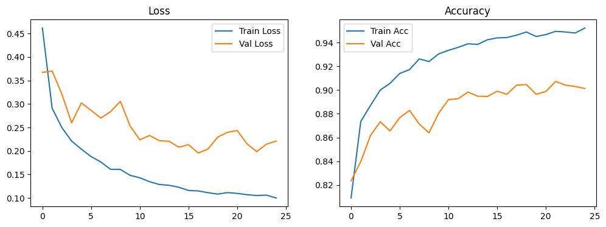
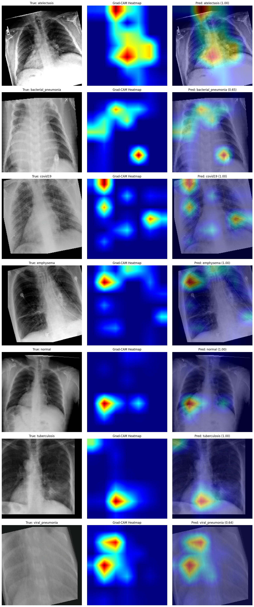
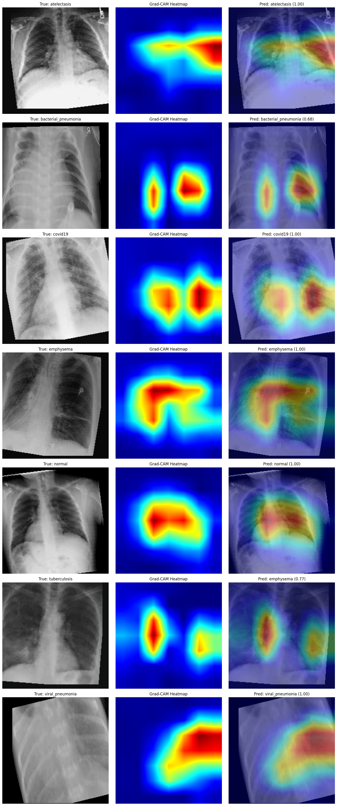

# Lung Disease Detection and Differentiation from Chest X-rays

**Final Year Project, BS Computer Science, The Islamia University of Bahawalpur (2022–2026)**
Project title: *A Novel Deep Learning-Based System for Identification and Differentiation of Lung Diseases*
Author: **Bilal Ilyas Jhandir** · Supervisor: **Mr. Syed Naseem Abbas Naqvi**

A deep learning system that reads a chest X-ray and classifies it into one of **seven classes**: atelectasis, bacterial pneumonia, COVID-19, emphysema, tuberculosis, viral pneumonia and normal. It also shows a **Grad-CAM heatmap** of the regions that drove the prediction.

| | |
|---|---|
| Dataset | 42,682 chest X-rays, built by me from 10 public sources and a local hospital |
| Architectures trained and compared | 7 (CNN classifiers, a Vision Transformer and object detection models) |
| Final models (in this repo) | ConvNeXt-Large and EfficientNetV2-L |
| Best test accuracy | **90.33%** (EfficientNetV2-L), 90.04% (ConvNeXt-Large), on 4,269 held-out images |
| Explainability | Grad-CAM on the last feature block of each network |

---

## Why this repo has only two models (please read this first)

The work behind this project was larger than the final report shows.

1. **I built the dataset myself.** To cover all seven conditions, I collected chest X-rays from ten public repositories plus 1,011 images from a local hospital, then preprocessed and merged them into one 7-class dataset of 42,682 images.
2. **I trained and compared seven architectures** on that dataset: CNN classifiers (**DenseNet, EfficientNet, ConvNeXt, CSPNeXt**), a Vision Transformer (**ViT-Base**), and object detection models (**YOLOv8, R-CNN**).
3. **My supervisor asked me to write the final report on the top performers only.** The two best were **ConvNeXt-Large** and **EfficientNetV2-L**, so the report, and the two notebooks here, cover those two models.

So the notebooks in this repository are the **final, documented runs** behind the report. They are not the whole project. The earlier comparison runs of the other five architectures are not included here.

---

## What's in this repository

```
.
├── README.md
├── notebooks/
│   ├── convnext_large_lung_xray.ipynb       # ConvNeXt-Large: training, evaluation, Grad-CAM
│   └── efficientnetv2_l_lung_xray.ipynb     # EfficientNetV2-L: training, evaluation, Grad-CAM
├── report/
│   └── FYP_Final_Report_Bilal_Ilyas_Jhandir.pdf   # Final project report (40 pages)
└── figures/                                 # Plots exported from the notebook outputs
```

Both notebooks were run end to end on Kaggle and saved **with their full outputs** (training logs for all 25 epochs, classification reports, confusion matrices and Grad-CAM figures). You can read the results on GitHub without running anything. I added short explanation cells to each notebook. The code and outputs are exactly as they were run.

---

## The dataset

**Classes:** atelectasis, bacterial pneumonia, COVID-19, emphysema, normal, tuberculosis, viral pneumonia.

**Sources** (as listed in the report):

| # | Source |
|---|---|
| 1 | [Labeled Chest X-Ray Images](https://www.kaggle.com/datasets/tolgadincer/labeled-chest-xray-images) (Kaggle) |
| 2 | [COVID-19 X-ray 10000 Images](https://www.kaggle.com/datasets/nabeelsajid917/covid-19-x-ray-10000-images) (Kaggle) |
| 3 | [Chest X-ray Masks and Labels](https://www.kaggle.com/datasets/nikhilpandey360/chest-xray-masks-and-labels) (Kaggle) |
| 4 | [Chest X-Ray Images (Pneumonia)](https://www.kaggle.com/datasets/paultimothymooney/chest-xray-pneumonia) (Kaggle) |
| 5 | [NIH Chest X-rays](https://www.kaggle.com/nih-chestxrays/data) (Kaggle) |
| 6 | [Lung Area Specific COVID-19 X-ray Dataset](https://www.kaggle.com/datasets/fsang2692/lung-area-specific-covid19-xray-dataset) (Kaggle) |
| 7 | [COVID Patients Chest X-ray](https://www.kaggle.com/datasets/ankitachoudhury01/covid-patients-chest-xray) (Kaggle) |
| 8 | [Image Classification COVID-19 X-ray](https://www.kaggle.com/datasets/thomasnibb/image-classification-covid19-xray) (Kaggle) |
| 9 | [Chest X-ray 6 Classes Dataset](https://www.kaggle.com/datasets/mohamedasak/chest-x-ray-6-classes-dataset) (Kaggle) |
| 10 | [Mendeley Data 8j2g3csprk v2](https://data.mendeley.com/datasets/8j2g3csprk/2) |
| 11 | 1,011 anonymised chest X-rays from a local hospital |

**Split** (80 / 10 / 10, seeded random split): 34,145 train · 4,268 validation · 4,269 test.

| Class | Train images | Test images |
|---|---:|---:|
| Normal | 11,142 | 1,407 |
| Viral pneumonia | 8,114 | 1,014 |
| Bacterial pneumonia | 4,603 | 598 |
| COVID-19 | 3,592 | 441 |
| Tuberculosis | 2,582 | 302 |
| Emphysema | 2,059 | 248 |
| Atelectasis | 2,053 | 259 |

The dataset is imbalanced (normal has more than 5× as many images as atelectasis), so training uses a weighted sampler, described below.

**The combined dataset is not redistributed in this repository.** It mixes images under several different licences with hospital images that I'm not able to share publicly.

---

## Method

Both notebooks use the same pipeline. Only the backbone changes.

| Step | Details |
|---|---|
| Backbone | ImageNet-pretrained `convnext_large` or `efficientnet_v2_l` from torchvision, last linear layer replaced with a 7-class head |
| Input | Resized to 224×224, ImageNet normalisation |
| Augmentation (train) | Random horizontal flip, ±15° rotation, 10% translation, brightness and contrast jitter |
| Class imbalance | `WeightedRandomSampler` with inverse-frequency class weights |
| Optimiser and loss | AdamW (lr 1e-4, weight decay 1e-2), cross-entropy |
| Training | 25 epochs, batch size 32, mixed precision (`torch.amp`), `nn.DataParallel` on 2× NVIDIA Tesla T4 (Kaggle) |
| Model selection | Weights from the epoch with the best validation accuracy |
| Evaluation | Classification report and confusion matrix on the held-out test split |
| Explainability | Grad-CAM hooked on `features[-1]`, one test image per class |

---

## Results

All numbers come straight from the saved notebook outputs.

| Metric | ConvNeXt-Large | EfficientNetV2-L |
|---|---:|---:|
| Best validation accuracy | 90.37% (epoch 19) | **90.72%** (epoch 22) |
| **Test accuracy** | 90.04% (3,844 / 4,269) | **90.33%** (3,856 / 4,269) |
| Test macro F1 | 0.92 | 0.92 |
| Test weighted F1 | 0.90 | 0.90 |
| Training time (25 epochs, 2× T4) | **253 min** | 323 min |

**Per-class F1 on the test set:**

| Class | ConvNeXt-Large | EfficientNetV2-L |
|---|---:|---:|
| Atelectasis | 0.99 | 1.00 |
| Bacterial pneumonia | 0.74 | 0.75 |
| COVID-19 | 0.96 | 0.96 |
| Emphysema | 0.98 | 0.98 |
| Normal | 0.99 | 0.99 |
| Tuberculosis | 1.00 | 0.99 |
| Viral pneumonia | 0.78 | 0.79 |

### What the results show

- **Five of the seven classes are close to solved** (F1 ≥ 0.96 for both models).
- **Nearly all remaining errors come from viral vs. bacterial pneumonia.** That one pair accounts for 371 of ConvNeXt-Large's 425 test errors (87%) and 356 of EfficientNetV2-L's 413 (86%). Most of it is viral pneumonia predicted as bacterial (306 and 305 images). The two look very similar on a radiograph, so this is the clear next problem to work on.
- **The two architectures end up almost tied.** EfficientNetV2-L is ahead by about 0.3 points of test accuracy. ConvNeXt-Large trained about 70 minutes faster.

### Confusion matrices (test set)

| ConvNeXt-Large | EfficientNetV2-L |
|---|---|
|  |  |

### Training curves

| ConvNeXt-Large | EfficientNetV2-L |
|---|---|
|  |  |

### Grad-CAM: where the model looks

For each class, one test image is shown with its heatmap and the overlay. Red marks the regions that contributed most to the prediction.

<details>
<summary><b>ConvNeXt-Large Grad-CAM (one image per class)</b></summary>



</details>

<details>
<summary><b>EfficientNetV2-L Grad-CAM (one image per class)</b></summary>



</details>

---

## Limitations and what I'd do differently

Looking back at the code after the project, these are the points I would fix in a follow-up.

1. **Augmentation also reaches the validation and test images.** In `get_data_loaders`, the training transform is set on the shared `ImageFolder` (`train_dataset.dataset.transform = train_transforms`). `random_split` returns views of that same object, so validation and test images are also randomly flipped, rotated and colour-jittered (you can see the tilted inputs in the Grad-CAM figures). The reported numbers are on augmented test images rather than clean ones. The fix is to build separate dataset objects for each split.
2. **The split is at image level, not patient or source level.** The classes come from different source datasets, so a model can in principle pick up source-specific cues (scanner, contrast, borders) as well as disease features. A split by patient and a test on a source it never saw in training would be a stronger evaluation.
3. **One run per model.** Each model was trained once with seed 42. Repeated runs with different seeds would show how much of the 0.3-point gap between the two models is noise.
4. **This is a research prototype, not a diagnostic tool.** It is meant to support a radiologist, never to replace one.

---

## How to run

The notebooks were written for **Kaggle** (GPU T4 ×2).

1. Prepare a dataset in `ImageFolder` layout with one folder per class:
   `atelectasis/ bacterial_pneumonia/ covid19/ emphysema/ normal/ tuberculosis/ viral_pneumonia/`
2. Attach it to the notebook and set `CONFIG['data_dir']` to its path.
3. Run the first code cell. It trains for 25 epochs, saves the weights (`convnext_chest_xray.pth` or `efficientnet_v2_chest_xray.pth`), then prints the test report and draws the confusion matrix and Grad-CAM figures.
4. *(Optional)* Set `test_image_path` in the second code cell to predict a single X-ray and view its heatmap.

Main dependencies: PyTorch, torchvision, scikit-learn, OpenCV, Pillow, matplotlib, seaborn.

On 2× T4 a full run takes about 4 to 5.5 hours.

---

## Final report

[`report/FYP_Final_Report_Bilal_Ilyas_Jhandir.pdf`](report/FYP_Final_Report_Bilal_Ilyas_Jhandir.pdf) is the 40-page project document submitted to the department. It follows the university's SRS/SDD template: introduction and scope, software requirements, system design and architecture, then implementation and testing, with the training curves, classification reports, confusion matrices and Grad-CAM results for both models.

---

## References

- Liu, Z., Mao, H., Wu, C.-Y., Feichtenhofer, C., Darrell, T., & Xie, S. (2022). *A ConvNet for the 2020s*. [arXiv:2201.03545](https://doi.org/10.48550/arXiv.2201.03545)
- Tan, M., & Le, Q. V. (2021). *EfficientNetV2: Smaller Models and Faster Training*. [arXiv:2104.00298](https://doi.org/10.48550/arXiv.2104.00298)
- Selvaraju, R. R., et al. (2017). *Grad-CAM: Visual Explanations from Deep Networks via Gradient-based Localization*. ICCV.
- The full literature list is in the report (section 1.4).

---

## Acknowledgements

Thanks to my supervisor, **Mr. Syed Naseem Abbas Naqvi**, for guiding the project, to the hospital that provided anonymised X-rays, and to the authors of the public datasets listed above.

## Contact

**Bilal Ilyas Jhandir** · [bilalilyasjhandir@gmail.com](mailto:bilalilyasjhandir@gmail.com) · [GitHub](https://github.com/bilalilyasjhandir) · [LinkedIn](https://linkedin.com/in/bilalilyasjhandir)
